# Bighiu Rareș

## What I build

- Offensive security: recon, exploitation, and red-team experiments
- Tools that detect and redact sensitive data
- AI security: prompt injection and phishing detection
- Network traffic analysis and visualization
- Hands-on cybersecurity labs

## Tools I reach for

## Find me

GitHub: [@Raresney](https://github.com/Raresney)

---

